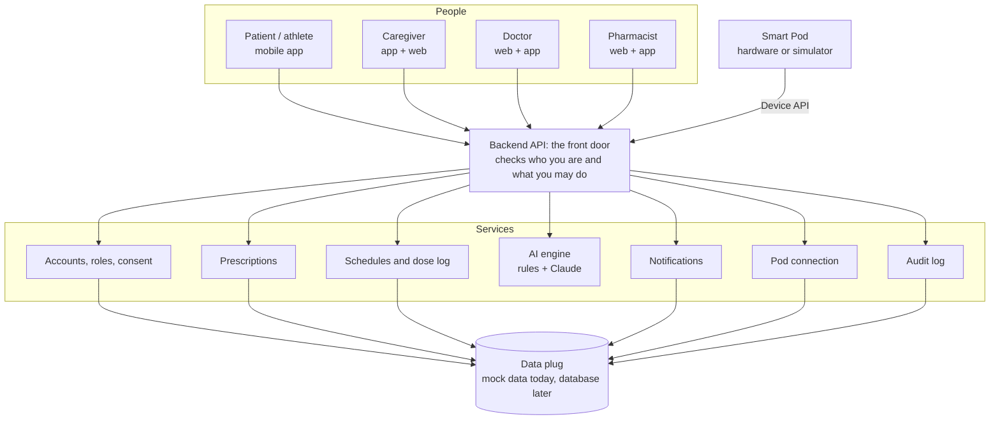

# Smart Pod

Software for **Smart Pod**: a medication and supplement dispenser with a mobile app, dashboards for doctors, pharmacists and caregivers, and an AI engine that warns about conflicts and finds the best time for each dose.

This repository is the **working prototype**. It runs entirely on **mock data** (no database, no cloud account), so anyone on the team can start it on a laptop in a few minutes. Every part is built so it can later be switched to a real backend without rewriting the apps.

> ⚠️ Prototype. The AI rules and all people are demo data. Nothing here is medical advice.

## What is in this repository

| Folder | What it is | Built with |
| --- | --- | --- |
| [`backend/`](backend) | The API every app talks to: accounts and roles, prescriptions, dose log, AI engine, notifications, Pod connection | Node.js + TypeScript, no outside libraries |
| [`web/`](web) | Web dashboards for **doctors**, **pharmacists** and **caregivers** | React + Vite |
| [`mobile/`](mobile) | The mobile app: sign-up with role choice, patient home, supplements, AI insights, Pod, sharing, caregiver and clinician views | Expo (React Native) |
| [`pod-simulator/`](pod-simulator) | Pretends to be the Pod hardware, using the same Device API the real Pod will use | Node.js |
| [`shared/`](shared) | The data types all parts share | TypeScript |
| [`docs/`](docs) | Plain-language documentation | |



## Quick start (about 5 minutes)

You need **Node.js 20 or newer** ([nodejs.org](https://nodejs.org), pick "LTS"). Full step-by-step guide, including the phone: **[docs/GETTING-STARTED.md](docs/GETTING-STARTED.md)**.

```bash
# 1. Backend (keep this window open)
cd backend
npm install
npm run dev          # → http://localhost:4000/api/health

# 2. Web dashboards (second window)
cd web
npm install
npm run dev          # → open http://localhost:5173

# 3. Pod simulator (third window, optional)
cd pod-simulator
node pod.mjs

# 4. Mobile app (fourth window) — see the guide for your phone's address
cd mobile
npm install
npx expo start       # scan the QR code with Expo Go
```

### Demo accounts

| Person | Role | Use it to see |
| --- | --- | --- |
| Dr. Salma Aoun | Doctor | Patient list, prescriptions, adding a medicine with an AI conflict check |
| Joseph Khoury | Pharmacist | Prescriptions (read only), pill levels, refills |
| Lina Haddad | Caregiver | Maria's doses today, missed-dose alerts |
| Maria Haddad | Patient (medication) | Mobile app with a simulated Pod |
| Karim Nassar | Patient (athlete) | Supplements and training-based timing |

A 10-minute walkthrough for presentations: **[docs/DEMO-SCRIPT.md](docs/DEMO-SCRIPT.md)**.

## Documentation

| Read this | When you want to |
| --- | --- |
| [Getting started](docs/GETTING-STARTED.md) | Install and run everything, including on your phone |
| [Architecture](docs/ARCHITECTURE.md) | Understand how the parts fit together |
| [Roles and permissions](docs/ROLES-AND-PERMISSIONS.md) | Know who can see and change what |
| [AI engine](docs/AI-ENGINE.md) | Understand or change conflict warnings and timing |
| [Data model](docs/DATA-MODEL.md) | See every table and field |
| [API reference](docs/API.md) | Call the backend directly |
| [Pod integration](docs/POD-INTEGRATION.md) | Build the Pod firmware (for the hardware team) |
| [Moving to a real backend](docs/MOVING-TO-SUPABASE.md) | Go from mock data to a pilot |
| [Demo script](docs/DEMO-SCRIPT.md) | Present the prototype |
| [Glossary](docs/GLOSSARY.md) | Look up a technical word |

## Checking that it works

```bash
cd backend && npm test     # 22 automatic tests: AI rules, permissions, doses, Pod
```
