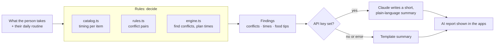

# The AI engine

The AI engine is part of the backend. Every time a medicine or supplement is added or changed, and whenever someone opens the AI report, it does three things:

| Job | Example |
| --- | --- |
| **Conflict warnings**: medicine with medicine, with supplement, with food | Warfarin + Aspirin: serious bleeding risk |
| **Best timing** for each item, keeping conflicting items apart | Levothyroxine 06:45 (empty stomach); Calcium 12:40, more than 4 hours later |
| **Food guidance** | Iron: take with orange juice, not tea or milk |

## How it works: rules decide, Claude explains



1. **Facts come from rules, not from the AI's memory.** `catalog.ts` holds each item's best timing; `rules.ts` holds conflict pairs with a severity (serious, moderate, minor) and advice. The same input always gives the same result, so it can be tested and checked by a pharmacist.
2. **The timing planner** (`planTiming` in `engine.ts`) places the strictest items first (medicines, then empty-stomach items). It tries each item's preferred slots (e.g. "45 minutes before breakfast"), and if a conflicting item is too close, moves it in 30-minute steps until they are far enough apart. It uses the person's routine (wake, meals, sleep, training), which they set in the app.
3. **Claude only explains.** If `ANTHROPIC_API_KEY` is set, Claude turns the findings into a short summary. Its instructions: use only the findings given, never add or remove one, never tell anyone to change a dose, and send serious issues to the doctor or pharmacist. If Claude is slow (more than 8 seconds) or fails, the template summary is used. Answers are cached, so the same report does not call Claude twice.

## Safety rules built in

- A **serious** conflict blocks the save. A doctor can confirm and save anyway, and the confirmation is in the audit log. A patient cannot. They are told to ask their doctor.
- Moderate and serious findings send a notification to the patient and their doctor.
- Every report carries a disclaimer: demo rules, not medical advice.
- Items not in the catalogue are saved but marked "could not be checked".

## Changing the rules

Add a conflict in `backend/src/ai/rules.ts`:

```ts
{ a: 'iron', b: 'calcium', severity: 'minor',
  reason: 'Calcium reduces iron absorption.',
  advice: 'Keep them about 2 hours apart.', separateHours: 2 },
```

- `a` and `b` are catalogue ids (order does not matter). For food rules, `b` is a food id from `FOODS`.
- `separateHours` tells the timing planner to keep them apart automatically.

Add an item in `backend/src/ai/catalog.ts`. `slots` lists the preferred times, best first. For example, `s('breakfast', -45)` means "45 minutes before breakfast".

Then run `npm test` in `backend/`.

## ⚠️ Before real patients

The catalogue and rules are **illustrative demo data**, chosen from well-known examples. They are not complete and not clinically validated. Before any pilot:

1. Replace `catalog.ts` and `rules.ts` with a **licensed drug and supplement database** (to be chosen at Gate 3). The engine's code stays the same: only the data source changes.
2. Have a **pharmacist review** the rules and the wording.
3. Complete the **medical-device (SaMD) assessment**: conflict warnings and timing advice are likely to make the software a regulated medical device in the EU.
4. Log every AI report shown, with the version of the rules used.
