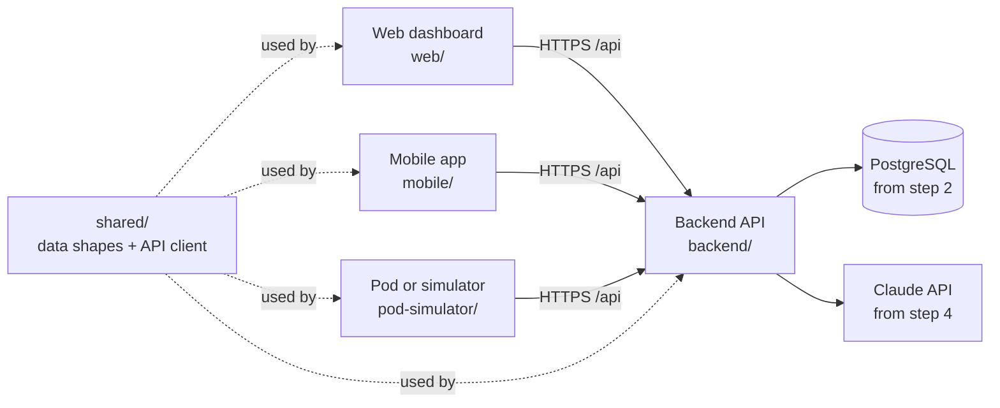

# Architecture: how the parts fit together

## The big picture

**The backend is the only part that decides anything.** Who may see or change what, whether two medicines conflict, what goes in the audit log: all of it happens on the server. The apps only display things and send requests. Anyone can change an app on their own device, so an app can never be trusted to enforce a rule.

## Layers: keep these three separate

Every part follows the same split, so you always know where code belongs:

| Layer              | Job                                                                 | Backend example                      | Web / mobile example                |
| ------------------ | ------------------------------------------------------------------- | ------------------------------------ | ----------------------------------- |
| **UI / HTTP**      | Talk to the outside world: receive a request, show a screen         | `backend/src/routes/*.ts`            | `src/App.tsx`, later `screens/`     |
| **Business logic** | The rules: "may this user do this?", "do these medicines conflict?" | `backend/src/services/*.ts` (step 2) | hooks such as `useBackendStatus.ts` |
| **Data access**    | Read and write stored data, or call another system                  | `backend/src/data/*.ts` (step 2)     | `shared/src/api/client.ts`          |

The rule of thumb: **a route never talks to the database directly, and a screen never calls `fetch` directly.** Each layer only calls the one below it. Then you can replace the database or redesign a screen without touching the rules.

## The shared package: one definition, used everywhere

`shared/` holds:

- **Schemas** (`shared/src/schemas/`): what each piece of data looks like, written with [Zod](https://zod.dev). From one schema we get (1) a TypeScript type for the editor and (2) a runtime check that rejects bad data. The backend uses it to validate input. The apps use it to validate what the backend sends back.
- **API client** (`shared/src/api/`): one function per backend endpoint, such as `getHealth()`. Web, mobile and the simulator call these instead of writing their own `fetch` code.
- **`parseEnv`**: checks environment variables at start-up.

Change a schema and TypeScript immediately shows you every place in every app that needs updating (run `npm run typecheck`).

## Where to change things

| I want to…                                | Change this                                                                                                                                                             |
| ----------------------------------------- | ----------------------------------------------------------------------------------------------------------------------------------------------------------------------- |
| Add a backend endpoint                    | Schema in `shared/src/schemas/` → route in `backend/src/routes/` → register it in `backend/src/app.ts` → client function in `shared/src/api/` → test in `backend/test/` |
| Add a setting (env variable)              | The schema in that part's `src/config.ts` **and** its `.env.example`                                                                                                    |
| Change a security header or error message | `backend/src/app.ts`                                                                                                                                                    |
| Add a web page                            | `web/src/` (step 6 adds routing and a `pages/` folder)                                                                                                                  |
| Add a phone screen                        | `mobile/src/` (step 6 adds navigation and a `screens/` folder)                                                                                                          |
| Change lint or format rules               | `eslint.config.js`, `.prettierrc.json`                                                                                                                                  |
| Change TypeScript strictness              | `tsconfig.base.json` (Node parts), `web/tsconfig.json`, `mobile/tsconfig.json`                                                                                          |

## How to scale, and when

Build for today and grow only when there's a real need. These are the planned upgrade paths:

| When this happens                      | Do this                                                                                                                                                   | Where                      |
| -------------------------------------- | --------------------------------------------------------------------------------------------------------------------------------------------------------- | -------------------------- |
| More users than one server can handle  | Run several copies of the backend behind a load balancer. This works because the backend keeps no state in memory (sessions and data live in PostgreSQL). | Hosting, not code          |
| Database gets slow                     | Add indexes for slow queries first; then a managed PostgreSQL with read replicas                                                                          | `backend/prisma/` (step 2) |
| Many real Pods sending data constantly | Add MQTT (a messaging system built for devices) next to the HTTPS Device API                                                                              | New `backend/src/devices/` |
| Slow work blocks requests (AI, emails) | Move it to a background job queue                                                                                                                         | New `backend/src/jobs/`    |
| The backend file count gets large      | Group by feature (`backend/src/prescriptions/{routes,service,data}.ts`) instead of by layer                                                               | `backend/src/`             |

## Security choices already in place

- Settings are checked at start-up, and secrets are read only from `.env` files, which git ignores.
- Security headers on every response (`@fastify/helmet`).
- Users only ever see generic error messages. Details go to the server log, with login tokens and cookies removed (redacted).
- By default the backend only listens on this computer (`127.0.0.1`).
- The local database is only reachable from this computer.
- In development, the web app reaches the backend through Vite's proxy, so the backend doesn't need to allow other websites (CORS stays closed).
- Exact dependency versions are pinned in `package-lock.json`, and `.npmrc` keeps new installs pinned too.

Added in later steps: login with Argon2-hashed passwords, role checks on every endpoint (deny by default), the audit log, HTTPS in production, encryption at rest for health data, and removing identifiers before anything is sent to Claude.
