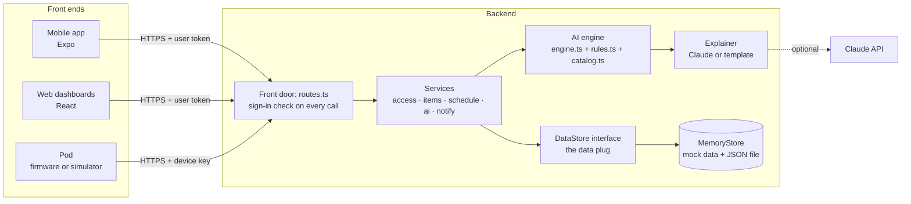
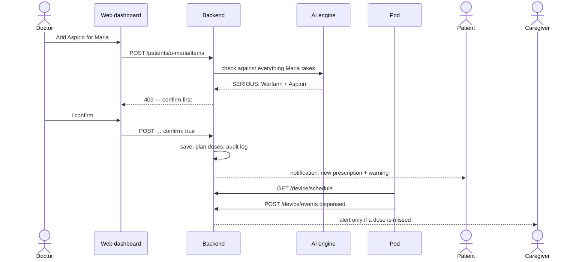

# Architecture

**One backend, five products.** The Pod, the mobile app and the three dashboards all talk to one backend. The backend holds the data, enforces who may do what, runs the AI engine and connects the Pods. The apps never touch data directly.

## The parts



| Layer | Folder | Job |
| --- | --- | --- |
| Front door (API) | `backend/src/routes.ts`, `backend/src/http/router.ts` | Lists every URL. Checks the token (people) or device key (Pods) before anything else. |
| Services | `backend/src/services/` | The rules of the product: permissions, prescriptions, dose log, reminders, alerts, audit. |
| AI engine | `backend/src/ai/` | Conflicts, timing and food guidance from rules; plain-language summary from Claude. |
| Data plug | `backend/src/store/DataStore.ts` | A fixed list of tables and operations. Mock today, database later. |
| Mock data | `backend/src/store/MemoryStore.ts`, `seed.ts` | Keeps data in memory, saves it to `backend/data/demo-db.json`. |
| Background job | `tick()` in `backend/src/services/schedule.ts` | Every 30 s: creates today's doses, sends reminders, marks missed doses, alerts caregivers, marks Pods offline. |

## Three design choices that keep it scalable

1. **The data plug.** Every service reads and writes through `DataStore`. Its methods already return Promises, like a real database. Moving to Supabase means writing one new file (`SupabaseStore`) and changing one line in `app.ts`. See [MOVING-TO-SUPABASE.md](MOVING-TO-SUPABASE.md).
2. **The device plug.** A dose can be confirmed by the user ("confirmed by you"), a caregiver, or a Pod ("confirmed by Pod"). Every Pod — simulator, our hardware, a partner's — uses the same small Device API. See [POD-INTEGRATION.md](POD-INTEGRATION.md).
3. **One dose log.** Every planned dose is a row that moves from `due` to `taken`, `missed` or `skipped`. Adherence, caregiver alerts, pharmacist usage and pill counts are all read from it.

## One prescription change, end to end



## Mock now, real later

| Piece | In this prototype | In the pilot |
| --- | --- | --- |
| Database | In memory + JSON file | Supabase (PostgreSQL), EU region |
| Sign-in | Pick a demo account; token `demo.<userId>` | Supabase Auth (email link or password), verified doctor licences |
| Permissions | Checked in `services/access.ts` | Same checks, plus database row-level security |
| Notifications | Rows the apps show as a list | Same rows + push messages (Expo push) |
| Background job | `setInterval` every 30 s | Scheduled function (Supabase cron) |
| AI facts | Demo catalogue and rules | Licensed drug and supplement database, pharmacist-reviewed |
| AI wording | Claude (if key set) or template | Claude, with logging and review |
| Pod | Simulator | ESP32 firmware over HTTPS (MQTT at scale) |

## Folder map

```
smartpod/
├─ shared/src/index.ts        every data type (User, Item, DoseEvent, AiReport …)
├─ backend/
│  ├─ src/server.ts           starts the API and the background job
│  ├─ src/app.ts              wires store + AI + routes together
│  ├─ src/routes.ts           every URL (the front door)
│  ├─ src/http/router.ts      tiny router: matching, JSON, errors, CORS
│  ├─ src/services/           access, items, schedule, ai, notify
│  ├─ src/ai/                 catalog, rules, engine, explainer
│  ├─ src/store/              DataStore (the plug), MemoryStore, seed
│  └─ test/                   automatic tests
├─ web/src/
│  ├─ App.tsx                 sign-in, header, page choice
│  ├─ api.ts                  every call to the backend
│  ├─ pages/                  PatientList, PatientDetail, Prescriptions, Notifications, Login
│  └─ components/ui.tsx       badges, bars, AI report view
├─ mobile/
│  ├─ app/                    one file per screen (expo-router)
│  │  ├─ index.tsx, register.tsx       welcome, sign-up with role choice
│  │  ├─ (patient)/                    today, items, insights, pod, me
│  │  └─ (care)/                       patients, patient/[id], alerts, profile
│  └─ src/                    api, auth, theme, ui building blocks
└─ pod-simulator/pod.mjs      fake Pod using the Device API
```
