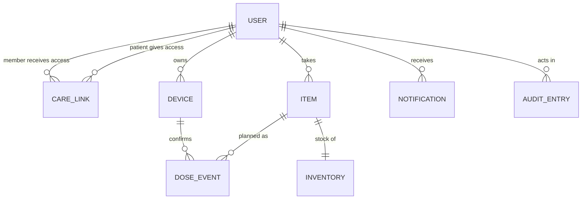
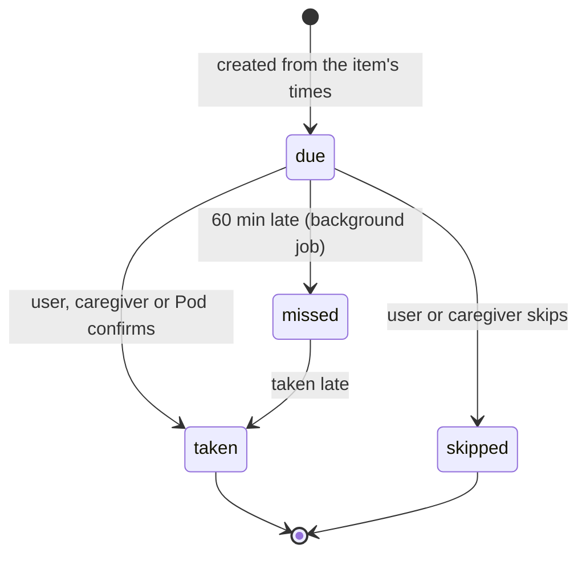

# Data model

Eight tables. The exact fields are in [`shared/src/index.ts`](../shared/src/index.ts); this page explains them. Think of each table as a sheet in a spreadsheet, linked by ids.

| Table | One row is | Key fields |
| --- | --- | --- |
| **users** | A person | `role` (patient, doctor, pharmacist, caregiver), `segment` (medication, athlete, wellness), `routine` (wake, meals, sleep, training), `licenceNumber` for doctors |
| **careLinks** | Consent: a patient gave someone access | `patientId`, `memberId`, `memberRole`, `grantedAt`, `revokedAt` (set when removed) |
| **items** | A medicine or supplement someone takes | `kind`, `catalogId` (link to the AI catalogue), `dose`, `times` ["08:00"], `instructions`, `status` (active, stopped), `prescribedBy` |
| **doses** | One planned dose and what happened. **The core log.** | `plannedAt`, `status` (due, taken, missed, skipped), `confirmedBy` (user, pod, caregiver), `actualAt`, `deviceId` |
| **inventory** | Pills left for an item | `count`, `refillAt` (warn at this level) |
| **devices** | A phone or Pod | `type` (phone, simulated-pod, pod), `online`, `battery`, `lastSeenAt`, `deviceKey` (never sent to apps) |
| **notifications** | An alert for one person | `kind` (reminder, missed-dose, conflict-warning, prescription-changed, refill, device), `title`, `body`, `readAt` |
| **audit** | A record of who did what | `actorId`, `action` (e.g. `item.update`), `patientId`, `detail`, `at` |

## How a dose moves

- Doses are created for **today and future days** when needed. Past days keep their history.
- Changing an item's times removes its future, not-yet-taken doses and creates new ones.
- A time set after it already passed today starts tomorrow, so no dose is instantly "missed".
- Taking a dose lowers the pill count by one. At the refill level, the patient and pharmacist are told.

## Rules that keep the data trustworthy

- **Never delete a dose that happened.** Corrections are new events in the audit log.
- **Every row carries `patientId`.** In the real database this is what row-level security uses to show each person only their rows.
- **Device keys are secret.** Apps see devices without their key. The key is shown once, when a Pod is paired.
