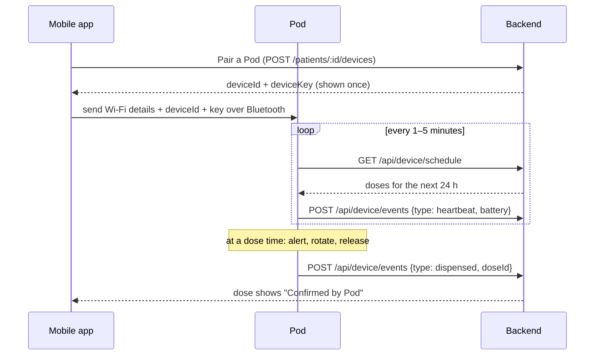

# Pod integration (for the hardware team)

The Pod is the main device. It connects to the **same backend** as the apps, through a small **Device API**. The simulator in `pod-simulator/` already speaks this API, so firmware can be tested against a real backend from day one.

## What the Pod does



## The contract

Every request carries:

```
X-Device-Id:  pod-maria-01
X-Device-Key: demo-pod-key
```

**1. Get the schedule**: `GET /api/device/schedule`

```json
{
  "deviceId": "pod-maria-01",
  "serverTime": "2026-11-05T17:58:00.000Z",
  "doses": [
    { "doseId": "dose_i-warf_2026-11-05_1900", "itemId": "i-warf", "name": "Warfarin", "dose": "5 mg", "plannedAt": "2026-11-05T19:00:00.000Z" }
  ]
}
```

**2. Report events**: `POST /api/device/events`

| Event | Body | Backend does |
| --- | --- | --- |
| Heartbeat | `{ "type": "heartbeat", "battery": 82, "firmware": "0.3.1" }` | Marks the Pod online; under 15% battery alerts the patient |
| Dose released and confirmed | `{ "type": "dispensed", "doseId": "…", "battery": 81 }` | Marks the dose taken, "confirmed by Pod"; lowers the pill count |
| Jam or fault | `{ "type": "jam" }` | Alerts the patient and caregivers |

- A dose can be released from **2 hours before** its time; earlier gives `409`.
- A Pod not heard from for **10 minutes** shows as offline.
- `401` means a wrong id or key.

## Rules for the firmware

1. **Keep working offline.** Store the last schedule on the Pod. Dispense on time even without internet, and send the `dispensed` events when back online (each `doseId` once).
2. **Confirm with a sensor.** Send `dispensed` only when the drop sensor sees the pill leave, not when the motor turns.
3. **Use the server's clock.** Use `serverTime` to correct drift.
4. **Never store Wi-Fi passwords or keys in plain text** on the real device.
5. **No controlled substances** in the Pod (project decision).

## Suggested hardware starting point

| Part | Suggestion | Why |
| --- | --- | --- |
| Controller | ESP32-S3 | Wi-Fi + Bluetooth built in, low cost, large community |
| Dispensing | Stepper motor + rotating carousel | Precise, simple to control |
| Confirmation | IR break-beam sensor at the outlet | Confirms the pill actually left |
| Alerts | Buzzer + LED ring | Visible and audible reminder |
| Power | Mains + backup battery | Keeps the schedule through power cuts |

Firmware can be written in C++ with the Arduino framework, using its `HTTPClient` and `ArduinoJson` libraries to call the two URLs above.

## Later, at scale

For many thousands of Pods, the same messages move to **MQTT** (a lightweight messaging system for devices, e.g. AWS IoT Core) with one certificate per Pod instead of a shared key. The backend's Pod connection service is the only part that changes. The apps and the dose log stay the same.

## Testing with the simulator

```bash
cd pod-simulator
node pod.mjs           # releases each dose at its time
node pod.mjs --now     # releases the next dose now (if within 2 hours)
node pod.mjs --jam     # reports a jam
```

To test a new Pod: pair it in the mobile app (Pod tab → Pair a Pod), copy the id and key into `pod-simulator/.env` (see `.env.example`), and run the simulator.
